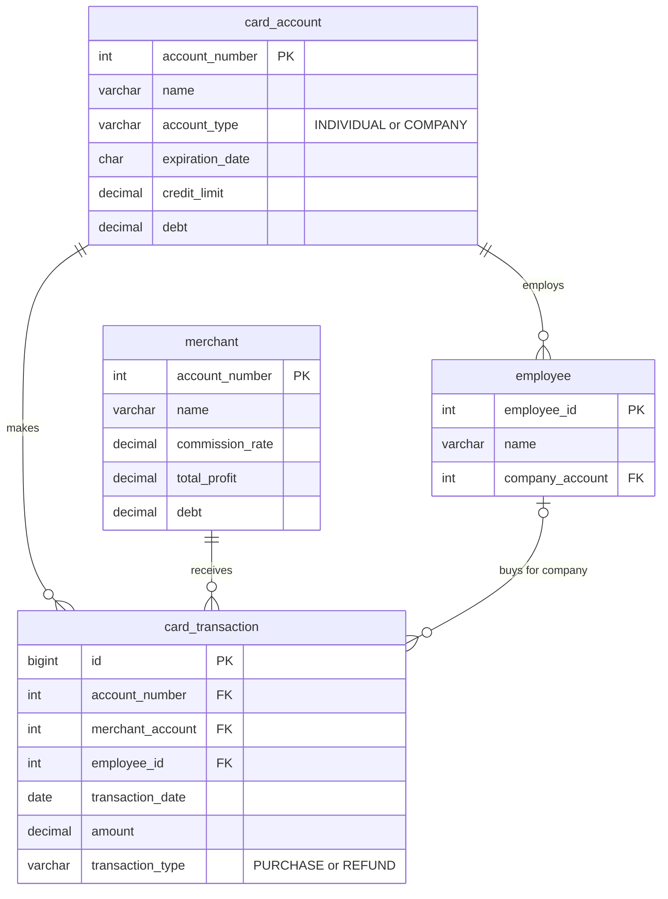

# Credit Card Management System

**VCT Credit Card Company**: a desktop credit card management system built with **Java (Swing)** and **MySQL**.
Individuals, companies and merchants can open accounts, make purchases and refunds, repay
debt and browse their transaction history. Management reports rank the best and worst
customers and pick the merchant of the month.

## Features

| Who | What they can do |
|---|---|
| **Individuals** | Register with a credit limit, buy from merchants, return products, repay debt, see their history by date range, delete the account (only when the balance is zero) |
| **Companies** | Everything an individual can do, plus purchases made by **employees** with the company card and a per-employee history |
| **Merchants** | See their profit and the **commission** they owe VCT on every sale, pay the commission, see their sales history |
| **Management** | Best customers (no debt, highest spend), worst customers (highest credit usage), merchant of the month (highest net sales) |

Business rules enforced by the service layer:

- A purchase is rejected if it exceeds the available credit (`credit limit - debt`).
- Each sale is split between the merchant's profit and the commission owed to VCT.
- A refund can never exceed what the customer actually spent at that merchant.
- Only registered employees of a company can use its card.
- Accounts with an outstanding balance cannot be deleted.

## Tech stack

- **Java 17**, Swing with the [FlatLaf](https://www.formdev.com/flatlaf/) look and feel
- **MySQL 8** through plain **JDBC** (`PreparedStatement` everywhere, no string-built SQL)
- **Maven** build, **JUnit 5** tests on an in-memory **H2** database in MySQL mode


## Architecture

```
com.vct.creditcard
├── App                 entry point: creates the schema, loads demo data, opens the UI
├── db                  connection settings, schema creation, demo data
├── model               immutable records: CardAccount, Merchant, CardTransaction, ...
├── service             business rules and all SQL (one class per area)
└── ui                  Swing windows; they only talk to the services
```

Every purchase or refund updates three tables (customer, merchant, transaction log). The
service runs these updates inside one database transaction with row locks
(`SELECT ... FOR UPDATE`), so balances stay consistent even if two windows act at once.
Money is handled as `BigDecimal` and stored as `DECIMAL(14,2)`.

### Database schema



## Running it

Requirements: JDK 17+, Maven, and a running MySQL 8 server.

```bash
mvn package
java -jar target/credit-card-management-system.jar
```

On first start the app creates the `credit_card_company` database and fills it with
fictional demo data. Connection settings come from environment variables:

| Variable | Default |
|---|---|
| `CCC_DB_HOST` | `localhost` |
| `CCC_DB_PORT` | `3306` |
| `CCC_DB_NAME` | `credit_card_company` |
| `CCC_DB_USER` | `root` |
| `CCC_DB_PASSWORD` | *(empty)* |

Try logging in as the individual **Eleni Kostaki**, the company **Cretan Tech Ltd** or the
merchant **Harbour Electronics**.

## Tests

```bash
mvn test
```

The tests cover registration, purchases, refunds, credit limits, employee purchases,
debt repayment, account deletion and the reports. They run against H2, so no MySQL server
is needed.

## Background

Originally built as a team project for the **CS-360 Databases** course at the
University of Crete (2022) by **Giannis Chiras** and **Giannis Vlachogiannakis**.
Refactored in 2026: SQL injection fixes, a proper service layer, transactional updates,
bug fixes, the previously unfinished history and report screens, and tests.
